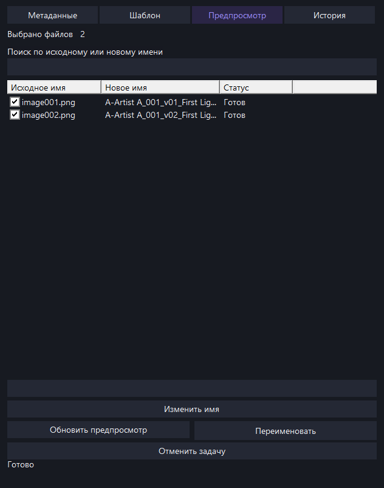

# Viewery

Нативный просмотрщик фото, GIF и видео для Windows 11 x64. Viewery работает с локальными файлами и каталогами. Воспроизведение и экспорт не требуют подключения к интернету после загрузки зависимостей.

## Коллекция и переименование

Версия Next 0.2.0-beta.1 добавляет отключаемый Rename Studio, локальную коллекцию, предпросмотр массового переименования и историю с Undo после перезапуска.



[Скачать выпуски Windows x64](https://github.com/GlimFox/Viewery/releases) · [История изменений](CHANGELOG.md)

1. На миниатюрах выберите файлы через Ctrl+клик, Shift+клик или Ctrl+A. В меню каталога можно включить чекбоксы. Выделенные файлы отмечены отдельно от текущего изображения. Выбор других миниатюр с Ctrl или чекбоксами сохраняет открытое изображение.
2. Кнопка «Переименование» открывает правую панель. На вкладке «Метаданные» назначьте художника, работу и номер версии. Соавторов перечислите через точку с запятой. Выберите отдельные работы, версии одной новой работы или существующую работу. Номера сохраняются в базе, добавление файлов не перенумеровывает коллекцию.
3. На вкладке «Шаблон» добавьте блоки имени, перетащите их или измените порядок кнопками. У каждого блока есть текст, число цифр, префикс, суффикс, запасное значение и регистр. Сохраните пресет или импортируйте/экспортируйте его как JSON.
4. На вкладке «Предпросмотр» нажмите «Обновить предпросмотр». Проверьте старые и новые имена, исправьте выбранное имя или снимите чекбоксы отдельных строк. «Переименовать» запрашивает подтверждение всей операции. Конфликты и занятые файлы не перезаписываются.
5. На вкладке «История» можно отменить завершённую операцию или восстановить незавершённую. Журнал сохраняется между запусками. Если файл изменён другой программой, Undo сообщает конфликт.

В меню каталога доступны группировки по художникам, работам, формату и каталогу, отдельная сортировка, фильтры версии/формата/художника и поиск. Совместные работы могут отображаться у нескольких художников, общий счётчик считает файл один раз. Alt+↑/↓ переключает группы художников. В меню можно выбрать Ctrl+Alt+↑/↓.

«Настройки → Модули → Rename Studio» отключает интерфейс и фоновые задачи модуля. База и пресеты сохраняются. Quick View открывает медиа без загрузки базы коллекции.

База находится в %LOCALAPPDATA%/Viewery/collection.sqlite3. Она хранит художников, работы, версии, связи с файлами, пресеты и журнал. В папках медиа дополнительные файлы метаданных не создаются. «Копия базы», «Экспорт JSON» и «Импорт JSON» доступны в панели. Файлы на поддерживаемых носителях сопоставляются по идентификатору файловой системы после внешнего переименования.

## Обновления и установка

Portable ZIP распаковывается в постоянный каталог. Медиакомпоненты устанавливаются через меню «Установить медиакомпоненты» с проверкой закреплённых SHA-256. Они хранятся отдельно в %LOCALAPPDATA%/Viewery/MediaTools.

В меню есть «Проверить обновления», «Что нового», установка доступного подписанного обновления и отключение автоматических проверок. Проверка выполняется в фоне. Подготовлен полный MSIX и канал App Installer, база и настройки расположены вне каталога установки.

Для выпуска доверенного установщика нужен сертификат подписи. На этом этапе сертификат отсутствует, первая установка подписанного MSIX и обновление между двумя установленными версиями ещё не проверены. [Сборка и выпуск](docs/RELEASE.md)

## Запуск

Если у вас уже есть `Viewery.exe`, скачайте медиадвижок и конвертер в ту же папку из PowerShell. Скрипт проверяет SHA-256 обоих архивов.

```powershell
.\Get-MediaTools.ps1 -Destination .
.\Viewery.exe
.\Viewery.exe --open "C:\Media\video.mp4"
```

В репозитории скрипт находится в `scripts\Get-MediaTools.ps1`. Можно открыть файл или папку через кнопку открытия либо перетащить их в окно. Повторный вызов с путём передаёт файл уже запущенному Viewery.

### Quick View в Проводнике

1. Запустите Viewery. Можно сразу запустить его командой `Viewery.exe --background`. Закрытие окна оставляет значок Viewery в области уведомлений.
2. В Проводнике выделите один поддерживаемый файл и нажмите **Space**. Пока предпросмотр открыт, выбор другого файла в том же окне Проводника обновляет его. Двойной щелчок по медиа открывает обычное окно, **Esc** закрывает предпросмотр. В меню по ПКМ также доступны открытие обычного окна, разворот на весь экран, закрепление и закрытие.
3. В меню **···** или в меню значка Viewery выберите **Сочетание Quick View**. Доступны **Space**, **Ctrl+Space**, **Ctrl+Shift+Space** и **Отключено**. Команда **Выйти из Viewery** завершает фоновый процесс.

Для проверки окна предпросмотра можно открыть файл напрямую командой `Viewery.exe --quick "C:\Media\video.mp4"`.

Viewery проверяет активную вкладку Проводника, фокус на списке файлов и одиночное выделение. Когда проверка не успевает завершиться или контекст не подходит, нажатие остаётся у Проводника. Если Space уже использует, например, PowerToys Peek, назначьте отдельное сочетание. Viewery проверяет системную регистрацию Ctrl-сочетаний, а утилиты с собственными клавиатурными хуками могут использовать тот же хоткей без системной регистрации. [Справка PowerToys Peek](https://learn.microsoft.com/windows/powertoys/peek)

Скрипт регистрирует **Открыть во Viewery** для текущего пользователя. При наличии подписанного пакета `Viewery.Explorer.msix`, который принимает Windows, команда появляется в основном меню. При отсутствии подписи она доступна через **Показать дополнительные параметры** или **Shift+F10**. [Документация Microsoft](https://learn.microsoft.com/windows/apps/desktop/modernize/integrate-packaged-app-with-file-explorer)

```powershell
.\scripts\Set-ExplorerIntegration.ps1 -Action Install -Executable .\build\bin\Release\Viewery.exe
# Опция -StartAtLogon добавляет запуск в фоне при входе в Windows.
.\scripts\Set-ExplorerIntegration.ps1 -Action Uninstall
```

В архиве из GitHub Actions установочный скрипт лежит рядом с программой. Для регистрации пункта меню из архива используйте `.\Set-ExplorerIntegration.ps1 -Action Install -Executable .\Viewery.exe`.

Для выпуска пакета первого уровня в установленном Windows SDK нужны MakeAppx и SignTool. Укажите отпечаток имеющегося сертификата `CN=Viewery` с закрытым ключом в хранилище `CurrentUser\My`. Windows должна доверять сертификату для установки. [Регистрация пакета с внешним расположением](https://learn.microsoft.com/windows/apps/desktop/modernize/grant-identity-to-nonpackaged-apps)

```powershell
.\scripts\Build-ExplorerPackage.ps1 -Destination .\build\bin\Release -SigningThumbprint <отпечаток>
.\scripts\Set-ExplorerIntegration.ps1 -Action Install -Executable .\build\bin\Release\Viewery.exe
```

## Управление

| Клавиши / мышь | Действие |
| --- | --- |
| ← / → | Один фактический кадр назад / вперёд с автопаузой. Для фото это горизонтальное панорамирование. |
| Shift+← / → | −5 / +5 секунд по видео или GIF. |
| Alt+← / → | Предыдущий / следующий файл в порядке сортировки каталога. |
| Space, щелчок ЛКМ по видео или GIF | Пауза / воспроизведение. |
| Колесо | Громкость для видео, масштаб для фото и GIF. Над значком динамика колесо двигает ползунок громкости. |
| Ctrl+колесо, + / −, 0 | Масштаб, сброс по 0. |
| ЛКМ с перетаскиванием | Перемещение окна. |
| Ctrl+ЛКМ с перетаскиванием | Панорамирование медиа в окне. |
| Двойной щелчок по медиа | Из Quick View открывает обычное окно, в обычном окне переключает полный экран. |
| F11 | Полный экран. Esc возвращает обычное окно. |
| Щелчок по счётчику времени | Переключение между `чч:мм:сс` и приблизительным счётчиком кадров. Выбор сохраняется при смене файла до выхода из Viewery. |
| ЛКМ / ПКМ по кнопке стоп-кадра | Скопировать текущий кадр в буфер обмена / сохранить его как PNG. |
| F4, I | Скрыть или вернуть каталог, показать или скрыть сведения о файле. |
| Ctrl+O, Ctrl+Shift+O | Открыть файл или папку. |

Кнопки в верхней строке скрывают каталог или переключают его между левой панелью и нижней лентой. В заголовке каталога через **···** доступны список или миниатюры, их размер и сортировка. Перетаскивание разделителя меняет размеры панели. Сортировка по имени, дате изменения, размеру или расширению определяет порядок навигации. Миниатюры загружаются для видимых карточек и соседних элементов средствами Windows.

Панель воспроизведения занимает место под медиа. Длинное имя прокручивается в выделенной области панели, расширение файла остаётся на месте. У фото в Quick View внизу остаётся только имя файла.

Панель **Экспорт медиа** доступна для видео. Поля **От** и **До** изначально охватывают весь ролик. Выберите поле и нажмите кнопку рядом с ним, чтобы подставить текущую позицию таймлайна. Границы также можно ввести вручную в секундах или как `чч:мм:сс.мс`. После выбора качества нажмите **Экспортировать**, чтобы выбрать путь сохранения. Экспорт можно отменить. Конвертер создаёт новый файл и отклоняет попытку перезаписать существующий.

| Пресет | Максимальная длинная сторона | FPS | Цветов |
| --- | ---: | ---: | ---: |
| Компактный | 480 px | 10 | 96 |
| Сбалансированный | 720 px | 15 | 192 |
| Высокое качество | 1080 px | 24 | 256 |

GIF ограничен палитрой и не содержит звуковой дорожки. Пресеты меняют разрешение, частоту кадров и число цветов. Итоговый размер зависит от материала и может превышать размер исходного видео.

## Сборка и проверки

Для сборки нужны Visual Studio 2022 или новее с компонентом **Desktop development with C++**, Windows SDK и CMake 3.25+. Генератор Visual Studio 2026 требует CMake 4.2+.

```powershell
cmake -S . -B build -G "Visual Studio 17 2022" -A x64 -DVIEWERY_MEDIA_TESTS=ON
cmake --build build --config Release --parallel
.\scripts\Get-MediaTools.ps1 -Destination .\build\bin\Release
ctest --test-dir build -C Release --output-on-failure
.\build\bin\Release\Viewery.exe
```

Для Visual Studio 2026 укажите `-G "Visual Studio 18 2026"`. Для Ninja можно выполнить те же шаги из x64 Developer PowerShell, указав `-G Ninja -DCMAKE_BUILD_TYPE=Release` и каталог `build/bin` для бинарников. Если локализованный инструментарий не проходит пробу компилятора с Ninja, укажите `-DCMAKE_TRY_COMPILE_CONFIGURATION=Release -DCMAKE_MSVC_DEBUG_INFORMATION_FORMAT=Embedded` на этапе конфигурации.

CTest создаёт тестовые PNG, GIF и MP4 без внешних образцов. Проверяются кадры 0,0 → 0,1 → 0,2 → 0,4 → 0,2 секунды в GIF и MP4 с переменной частотой кадров, автопауза, перемотка, масштаб, скорость и громкость. Отдельная проверка запускает FFmpeg для целого видео и фрагмента, проверяет отмену, Unicode в путях и защиту от перезаписи. Для сборки одного приложения оставьте `VIEWERY_MEDIA_TESTS` выключенным.

На GitHub Actions workflow [Windows x64 build](.github/workflows/windows.yml) собирает приложение на Windows runner, загружает проверенные зависимости, запускает CTest и выгружает `Viewery.exe` со скриптами и документацией. Права на медиазависимости и порядок их получения приведены в [THIRD_PARTY.md](THIRD_PARTY.md).

Дополнительные CTest проверяют модель коллекции, безопасное переименование и восстановление журнала, шаблоны, группировку, фильтры и проверку версий обновления. Проверка 10 000 файлов измеряет индексирование и построение групп без декодирования медиа. [Фактические результаты и ограничения Next](docs/NEXT_STATUS.md).

### Ручная проверка Проводника

- Откройте папку с GIF в режиме «Таблица», выделите файл и нажмите Space. Щёлкните по другому медиафайлу в этом же окне Проводника и проверьте, что предпросмотр обновился. Нажмите Esc в Quick View. Повторите в режиме крупных значков. При удержании Space ожидается однократное открытие.
- Нажмите F2 и введите пробел в имя файла. Проверьте пробел в поиске, адресной строке и другом приложении.
- Повторите с папкой, документом и двумя выбранными файлами. Нажмите Ctrl+стрелку, чтобы переместить фокус с выбранного медиа, и проверьте, что пробел остаётся у Проводника.
- Откройте разные видео в двух вкладках Проводника. Quick View должен открыть файл активной вкладки.
- Выберите Ctrl+Shift+Space, перезапустите Viewery и проверьте выбранное сочетание. Пункт **Отключено** выключает предпросмотр по хоткею.
- Установите пункт меню, откройте поддерживаемый файл через него и удалите интеграцию.

## Архитектура

- `src/main.cpp` содержит нативное Win32 окно, контроллер фонового процесса, команды и экспортную панель. Win32 выбран для небольшой сборки и запуска без установки Windows App SDK.
- `src/media.*` загружает libmpv из каталога приложения и выводит медиа через D3D11. Обратный покадровый шаг зависит от точности меток времени и возможностей перемотки контейнера. [Команды покадрового шага mpv](https://mpv.io/manual/stable/#list-of-input-commands)
- `src/explorer.*` проверяет фокус с помощью UI Automation и выбранный файл через Shell COM в STA-потоке. `src/shell_command.cpp` реализует команду первого уровня для подписанного пакета. `src/catalog.*` сканирует текущий каталог и получает миниатюры в фоновом потоке.
- `src/converter.*` запускает два прохода FFmpeg для оптимизации палитры GIF и сохранения результата. Встроенный предварительный просмотр экспорта, экспорт в другие форматы и произвольная настройка FPS или палитры выходят за границы MVP.
- `src/library.*` хранит коллекцию и журнал операций в системной SQLite; `rename_template.*` формирует имена, `rename_studio.*` реализует правую панель, `collection_view.*` строит виртуальные группы. `updater.*` проверяет выпуски GitHub и передаёт установку подписанного пакета Windows App Installer.
- Интерфейс русскоязычный. Диагностика сторонних медиакомпонентов может отображаться на английском. Поддерживаются JPG, PNG, BMP, WebP, TIFF, GIF, MP4, MOV, MKV, WebM, AVI и другие контейнеры. Возможность открыть конкретный файл зависит от его кодека.
