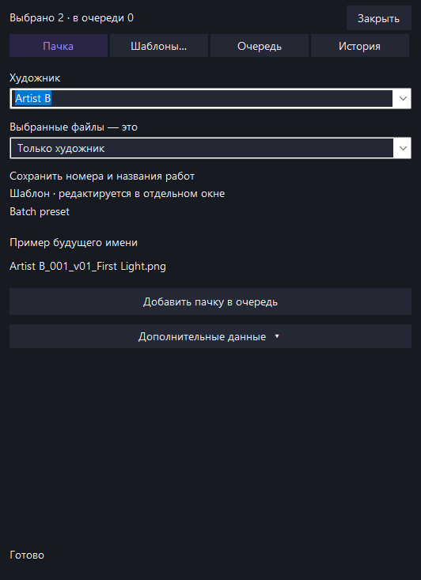

# Пачки и управление в beta.3

## Несколько пачек за одну операцию

1. Включите чекбоксы кнопкой в заголовке каталога и выберите первую пачку. Клик по изображению продолжает просмотр, не снимая чекбоксы.
2. Откройте «Переименовать». Введите художника, название и укажите, являются ли выбранные файлы отдельными работами или версиями одной работы. Пример показывает результат набираемых данных. Дополнительные поля раскрываются отдельно.
3. Нажмите «Добавить пачку в очередь». Подготовленные имена остаются неизменными при смене выделения, каталога и шаблона.
4. Выберите другую пачку, задайте другие данные и добавьте её. Вкладка «Очередь» показывает общий список, допускает исправление имени, исключение и удаление строк. Повторное добавление одного источника заменяет его строку.
5. «Переименовать всю очередь» подтверждает одну операцию. Конфликты проверяются по всему списку. История и Undo относятся к одной общей операции, включая файлы из разных каталогов.

«Шаблоны…» открывает отдельный изменяемый редактор пресетов. Изменения шаблона влияют на следующие пачки, уже утверждённые имена в очереди сохраняются. При необходимости строку очереди можно отредактировать или добавить её источник повторно.

Очередь хранится в памяти текущего сеанса. Закрытие панели её сохраняет; выход из приложения очищает. Если очередь не пуста, команда выхода требует подтверждения, а установка обновления откладывается. Пресеты, метаданные и история сохраняются в SQLite. Добавление пачки сохраняет её метаданные; файловые имена меняются после окончательного подтверждения. Undo восстанавливает имена файлов.

## Каталог и панели

Кнопка чекбоксов и переключатель «Все файлы / Художники» доступны прямо в каталоге. Группы сортируются по имени художника. Для файлов без назначенных метаданных распознаются распространённые схемы имён: `Artist_001_v01_Title`, `artist-123456-789`, `[Artist] Title`, `Artist - Title`. Распознавание используется для отображения, не записывает предположения в базу. Остальные файлы видимы в группе «Без художника». «Все файлы» снимает фильтры.

Границы левого каталога, нижней ленты и правой панели можно перетаскивать. Ширина правой панели запоминается. Окна шаблонов и настроек изменяют размер как обычные окна Windows.

В настройках находятся модуль коллекции, шаблоны, резервная копия, JSON, клавиши, обновления, медиакомпоненты и сведения о приложении.

## Управление

- ←/→ переключают файлы; ↑/↓ идут по строкам сетки миниатюр, а в ленте переключают файлы последовательно.
- Alt+←/→ — покадровый шаг для видео/GIF, панорамирование для фото. Shift+←/→ — перемотка на пять секунд.
- В Quick View один Space ставит паузу или продолжает воспроизведение. Второй быстрый Space закрывает окно. Удержание клавиши не считается двойным нажатием; начальный Space, открывший окно, тоже не считается первым нажатием пары.
- В обычном окне ЛКМ с перетаскиванием панорамирует медиа, Ctrl+ЛКМ перемещает окно. В Quick View эти два жеста меняются местами.

## Фактическая проверка

Release-сборка MSVC `/W4` прошла без предупреждений. Итоговый локальный прогон: **11 из 11 CTest прошли, без пропусков**, 19,59 с.

- Очередь: две разные пачки из двух каталогов; четыре файла переименованы одной операцией; исходные байты и посторонний файл сохранены; общий Undo вернул исходные имена. Проверены глобальные конфликты, редактирование/исключение/удаление/повторное добавление, смена выделения во время подготовки, замена шаблона и отдельный редактор.
- Основное окно: 91 утверждение, включая реальный MP4, паузу/воспроизведение, повтор Space, автоповтор клавиши, стрелки, панорамирование, три разделителя и новые кнопки каталога.
- Мерцание: 12 повторных компоновок не вызвали ни одного перемещения или перерисовки неподвижных кнопок; восемь чередующихся Ctrl+колёс не вызвали перестановки кнопок. Убраны повторные изменения Z-порядка и лишние обновления шрифтов.
- Настройки: 534 утверждения, размеры/DPI, прокрутка, подписи, Tab/Enter и Esc. Обновление состояния не вызывает обратные события и перерисовку всей формы.
- Space: 28 проверок тайминга, повторов, контекста Проводника и отделения открытия от управления.
- Группировка: Unicode, распознаваемые схемы имён, сохранение неизвестных файлов и неизменность метаданных. Сохранились проверки коллекции на 10 000 файлов, безопасного журнала, VFR-воспроизведения и GIF-экспорта.

GUI-тесты используют отдельный рабочий стол и временные базы. Они не устанавливают глобальные хуки, не меняют пользовательский реестр и не вызывают Shell или буфер обмена. Настоящий глобальный хук Проводника проверен компиляцией и тестами маршрутизации; весь интерактивный сценарий на пользовательском рабочем столе автоматически не воспроизводился.
